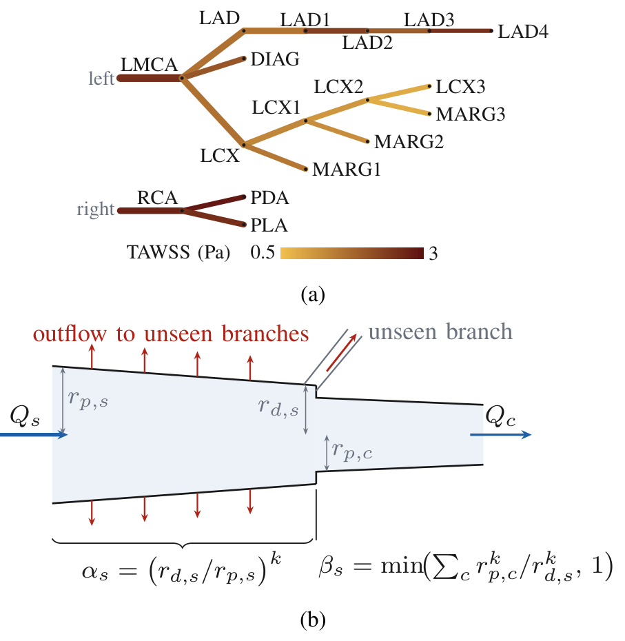
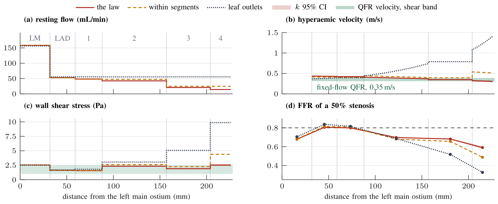
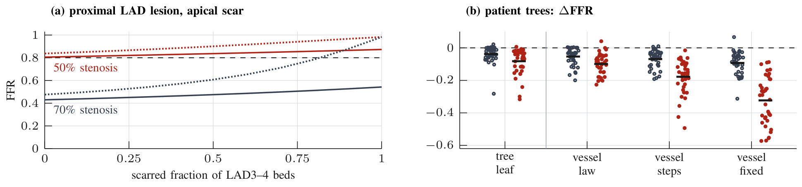
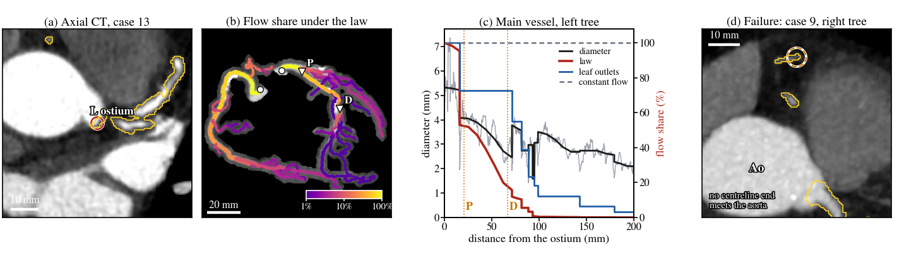
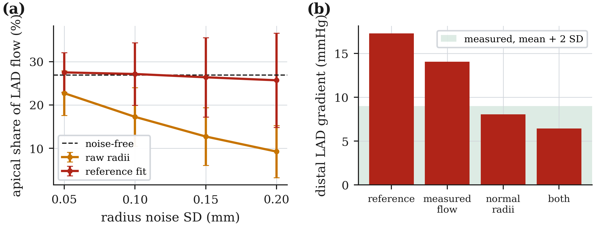

# Coronary Taper Flow

A mass-conserving outflow model for coronary arterial trees. The flow that each segment
loses to side branches too small to image is derived from the taper of its reference
lumen, and the model returns resting and hyperaemic flow, pressure, fractional flow
reserve (FFR), pulsatile waveforms and wall shear stress for every named segment. It
runs on a laptop CPU in milliseconds and needs no three-dimensional reconstruction or
computational fluid dynamics.

## Background

Angiography-derived FFR methods, such as the quantitative flow ratio (QFR), compute the
pressure loss along the visible epicardial vessels and therefore need the flow each
vessel carries. Most of that flow leaves through branches below the resolution of the
angiogram. Current approaches fix a population hyperaemic velocity, distribute flow only
at visible bifurcations, or place all outlets at the vessel tips. Murray's law,
$`Q = \kappa d^{k}`$, links flow to diameter, and the taper ratio of a single vessel has
been used to estimate the flow it loses along its length (Gosling et al., *J. Biomech.*
103:109698, 2020, [doi:10.1016/j.jbiomech.2020.109698](https://doi.org/10.1016/j.jbiomech.2020.109698)).

This work applies the relation along every segment and at every junction of a whole
tree. The result is a closed-form outflow model that conserves mass exactly, does not
depend on how the vessels are divided into segments, and needs only the reference
diameter that angiography software already measures. It also shows that the constant
velocity assumed by fixed-flow QFR is the special case $`k = 2`$ of the same law.

## Method

For a segment $`s`$ with proximal and distal reference radii $`r_{p,s}`$ and $`r_{d,s}`$,
Murray's law applied at every point along the lumen passes on the fraction

```math
\alpha_s = \left(\frac{r_{d,s}}{r_{p,s}}\right)^{k}
```

of the segment's inflow. Where a vessel steps down in diameter at a junction, the visible
daughters $`c`$ are together smaller than the parent's distal end, and the difference is
an unseen branch. The junction passes on

```math
\beta_s = \min\!\left(\frac{\sum_c r_{p,c}^{k}}{r_{d,s}^{k}},\; 1\right),
```

and the daughters share this flow in proportion to $`r_{p,c}^{k}`$. With the pooled
coronary exponent $`k = 2.39`$ (95 % CI 2.24 to 2.54), a segment that narrows from 4 to
3 mm passes on about half of its inflow, and a 3.0 mm vessel that continues at 2.8 mm with
no visible branch loses 15 % of its flow at that point.

<p align="center">
  
</p>

*(a) The 17-segment reference tree (line width: mean diameter; colour: time-averaged wall
shear stress under the law). (b) The law on one segment: a fraction α<sub>s</sub> of the
inflow passes along the segment and a fraction β<sub>s</sub> at its distal junction; the
rest leaves through unseen branches.*

Along a chain whose radius never increases, the fractions multiply to
$`(r_{\mathrm{end}}/r_{\mathrm{start}})^{k}`$, so cutting a segment in two does not change
the result. The junction term is what makes this hold: without it, a step in radius
between two segments would remove no flow while the same narrowing inside one segment
would. Because velocity scales as $`v = Q/\pi r^{2} \propto r^{\,k-2}`$, halving the radius
lowers the velocity by about a quarter under the law, whereas outflow only at the tips
would quadruple it. Radii first pass through a monotone reference-diameter fit, as
quantitative angiography reports a reference diameter function rather than raw edge
radii.

FFR follows from the pressure that this flow costs. Each segment is a tapered Poiseuille
conduit, and a stenosis with diameter reduction DS adds the Young–Tsai loss

```math
\Delta P = \frac{8\pi\mu L_t}{A_t^{2}}\,Q \;+\; K_t\,\frac{\rho}{2}\left(\frac{1}{A_t}-\frac{1}{A_0}\right)^{2} Q\,\lvert Q\rvert,
\qquad A_t = A_0(1-\mathrm{DS})^{2},\;\; L_t = 10\ \mathrm{mm},\;\; K_t = 1.52 .
```

Each segment drains into the myocardial bed it supplies; at maximal hyperaemia every bed
resistance falls fourfold, and a bed of which a fraction $`f`$ is scar keeps $`(1-f)`$ of
its conductance. A linear transmission-line solution of the same network, with an
intramyocardial pump at the outlets, gives the pulsatile waveforms and the time-averaged
wall shear stress (TAWSS).

## Results

### Reference tree

On the 17-segment tree of Duanmu et al. (2019), the law was compared with four other
outflow models: outflow within segments only, at junctions only, at the vessel tips only
(leaf outlets), and structured-tree outlets.

| Quantity | Leaf outlets | Outflow law |
|---|---|---|
| Hyperaemic velocity along the LAD | rises to 1.41 m/s at the apex | 0.31–0.44 m/s, close to the 0.35 m/s used by fixed-flow QFR |
| FFR, 50 % distal LAD stenosis | 0.52 | 0.68 |
| FFR, 70 % proximal LAD stenosis after an apical infarct | 0.98 | 0.54 |
| FFR, 50 % proximal LAD stenosis | 0.84 | 0.81 |
| Share of LAD flow reaching the apex | 100 % | 27 % |
| Apical TAWSS | 9.87 Pa | 2.53 Pa |

Leaf outlets err in both directions: they make distal stenoses look more severe and
proximal stenoses above an infarct look harmless, because all of the LAD flow is forced
through the distal vessel and is lost entirely when the apical beds are scarred. Under
the law, 61 % of LAD flow still perfuses viable myocardium after the infarct.



*Three outflow models along the LAD, from the left main (LM) ostium to the apex: (a)
resting flow, (b) hyperaemic velocity, (c) wall shear stress, (d) FFR of a 50 % stenosis
placed in the middle of each segment. Red band: the law over the 95 % CI of k; green:
the velocity of fixed-flow QFR and the intermediate shear band.*



*(a) FFR of 50 % and 70 % proximal LAD stenoses as the distal LAD and apical beds become
scar (solid: the law; dotted: leaf outlets; dashed: FFR 0.80). (b) FFR of 50 % stenoses
in 38 patient trees minus the full-tree law, for leaf outlets on the full tree and for
the main vessel alone with the law, visible-branch steps or constant flow (grey:
proximal; red: distal; bars: means).*

### Patient trees from CT angiography

The law was applied to 38 coronary trees from the CT angiograms of 20 patients in the
CCA dataset; 2 of 40 trees were excluded because no centreline end met the aorta. Each
tree received its share of resting flow, and 50 % lesions were placed at 25 % and 75 %
of the main vessel down to 2 mm diameter. The law sent a median 57 % (IQR 52–69 %) of
each tree's inflow to branches below CT resolution, and the Murray exponent at visible
bifurcations had a median of 2.69 (IQR 1.99–3.51).

Mean FFR change against the full tree with the law, with the number of the 38 decisions
at FFR 0.80 that change:

| Model | Proximal lesion | Distal lesion |
|---|---|---|
| Full tree, leaf outlets (as in CT-derived FFR) | −0.04 (3) | −0.08 (10) |
| Main vessel alone, the law | −0.05 (5) | −0.10 (11) |
| Main vessel alone, steps at visible branches (as in Murray-law QFR) | −0.07 (6) | −0.18 (25) |
| Main vessel alone, constant flow (as in fixed-flow QFR) | −0.09 (11) | −0.32 (32) |



*(a) Axial CT of case 13 through the left ostium with the annotated lumen. (b)
Vessel-isolated maximum-intensity projection with the extracted centrelines (width:
lumen radius; colour: share of the tree's inflow under the law) and the proximal (P) and
distal (D) stenosis sites. (c) Main vessel of the left tree: reference diameter and
share of ostial flow under the law, with leaf outlets and at constant flow; a 50 %
stenosis at D reads FFR 0.82 with the law, 0.50 with leaf outlets and 0.65 at constant
flow. (d) Failure case: the annotated right tree of case 9 begins in epicardial fat
anterior to the aortic root, so no centreline end meets the aorta and the tree is
excluded.*

The reference in this comparison is a model, not invasive FFR; no public dataset pairs
coronary anatomy with pressure-wire measurements.

### Ablations

| Component removed or changed | Output | Full model | Ablated |
|---|---|---|---|
| Taper term (junctions only) | FFR, 70 % proximal stenosis with apical scar | 0.54 | 0.80 |
| Junction term (segments only) | apical flow change when LAD1–LAD3 are merged | < 1e-13 % | 21 % |
| Both terms (leaf outlets) | FFR, 50 % distal LAD stenosis | 0.68 | 0.52 |
| Reference-diameter fit, 0.2 mm radius noise | bias in apical flow share (points) | −0.2 | −17.0 |
| Separation loss of the Young–Tsai element | largest FFR change (65 % stenosis) | – | 0.14 |
| Murray exponent ±20 % | largest FFR change | – | 0.011 |

### Robustness and agreement with measurement

Under Monte Carlo radius noise the law is biased on raw radii, because every spurious
narrowing sheds flow while a spurious widening is ignored; the monotone reference fit
removes this bias. In a virtual cohort of 200 perturbed anatomies the law raised the FFR
of a distal 50 % stenosis in 199 anatomies and lowered the FFR of a proximal 70 %
stenosis above an apical scar in all 200, relative to leaf outlets.



*(a) Share of LAD flow reaching the apex under radius noise, with raw radii and after the
reference fit (mean ± SD of 60 draws per level). (b) Lesion-free hyperaemic gradient in
the distal LAD as the inputs move to measured resting flow, normal radii, or both; the
band is the measured mean + 2 SD.*

Six of ten predicted quantities lie within two standard deviations of published human
measurements (`results/validation.csv`). The four that do not are the proximal LAD wave
speed (10.0 against 15.9 ± 1.8 m/s), the apical TAWSS (2.53 Pa, just above the 1–2.5 Pa
band) and the lesion-free hyperaemic gradients to the distal LAD and RCA, which fall
within two standard deviations once the measured resting flow and normal coronary
diameters are used (`results/gradient_decomposition.csv`).

## Installation

```bash
git clone https://github.com/farhatmasood/coronary-taper-flow.git
cd coronary-taper-flow
python -m venv .venv
source .venv/bin/activate          # Windows: .venv\Scripts\activate
pip install -e ".[dev]"
pip install -e ".[patients]"       # optional: patient trees from CT angiography
```

Python 3.10 or newer. The solver needs NumPy, SciPy and pandas; the optional extra adds
nibabel, scikit-image, networkx and Matplotlib for the patient pipeline. `environment.yml`
gives a pinned conda environment.

## Usage

Build the model and compute FFR:

```python
from coronary import model, experiments

m = model.build()                              # reference tree, outflow law, calibration
print(m.rest.total_inflow_ml_min)              # 250 mL/min at rest
print(m.hyperaemic().total_inflow_ml_min)      # 908 mL/min at hyperaemia

experiments.lesion_ffr(m, "LAD", 0.50)         # FFR of a 50 % proximal LAD stenosis: 0.805
experiments.ffr_crossing(m, "LAD")             # diameter stenosis at FFR 0.80: 0.505
```

`model.build(closure=...)` selects the outflow model: `"taper"` (the law, default),
`"segment"`, `"junction"`, `"leaf"` or `"structured"`. `model.build(reference_fit=False)`
uses the radii exactly as given.

To run the model on another tree, write a CSV with the columns described in
`data/README.md`:

```python
from coronary import geometry, model
m = model.build(tree=geometry.CoronaryTree.from_csv("my_tree.csv"))
```

All experiments on the reference tree (about 90 s on one core; outputs in `results/`):

```bash
python scripts/run_experiments.py
```

The patient study uses the training set of the CCA dataset (Yang et al., *IEEE Trans.
Med. Imaging* 44:259–269, 2025, [doi:10.1109/TMI.2024.3435714](https://doi.org/10.1109/TMI.2024.3435714)),
released under GPL-3.0 at <https://huggingface.co/datasets/MedHK23/CCA> and not
redistributed here. The folder passed as `--data` holds `labels/<i>.nii.gz` and
`images/<i>.nii.gz`. The volumes state 0.5 mm voxels but have been resampled twofold, so
the script uses 0.25 mm.

```bash
python scripts/patient_study.py --data <path to the CCA training set>
```

Tests:

```bash
python -m pytest
```

## Repository structure

```
src/coronary/          model package
  model.py             builder: geometry, outflow model, calibration
  coronary_bc.py       outflow models and microvascular outlets
  geometry.py          segment geometry, tree topology, reference-diameter fit
  stenosis.py          Young–Tsai stenosis element
  steady_solver.py     nonlinear network solve for mean flow and pressure
  pulsatile_solver.py  transmission-line solve for waveforms
  ffr.py, wss.py       FFR and wall shear stress
  patient.py           coronary trees from CT angiography lumen masks
  experiments.py       experiments as plain functions
scripts/
  run_experiments.py   all experiments on the reference tree
  patient_study.py     the law on the CCA patient trees
data/                  reference tree geometry and published measurements
results/               experiment outputs (CSV, JSON)
tests/                 unit and physiological tests
```

## Citation

```bibtex
@unpublished{masood2026coronarytaper,
  title  = {Coronary Taper Specifies Side-Branch Outflow: A Mass-Conserving Flow Model
            and Its Implications for Angiography-Derived {FFR}},
  author = {Masood, Rao Farhat and Safdar, Aon and Bilal, Muhammad and Shiram, Muhammad Ali},
  year   = {2026},
  note   = {Manuscript under review}
}
```

## License

MIT, see [LICENSE](LICENSE). The reference geometry is from Duanmu et al., *Front.
Physiol.* 10:853 (2019), [doi:10.3389/fphys.2019.00853](https://doi.org/10.3389/fphys.2019.00853),
used under its CC BY licence.
